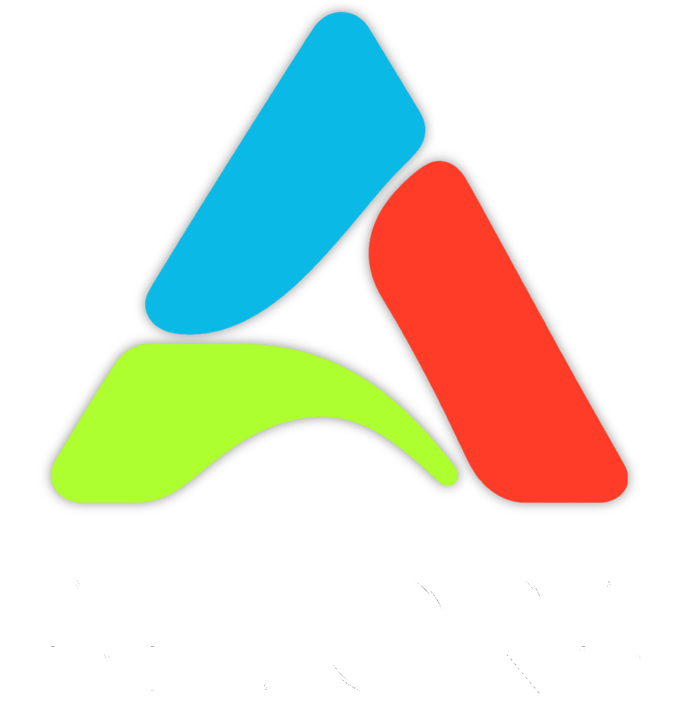

<!-- SPDX-License-Identifier: GPL-3.0-or-later -->

<!-- Copyright 2026 the NXAevora contributors -->

<p align="center">
  
<p>
<p align="center">
  
  
  
  
  
  
<p>
<p align="center">
NXAevora is a project to run Pokemon Legends Arceus natively on a Windows PC. The code of the game is translated
ahead of time from ARM64 to x86-64 with the static recompiler [ScarletNX](https://github.com/scarletnx/ScarletNX).<br>
NXAevora adds the settings, patches and tools that are specific to this game, and a launcher is planned.
<p>

> [!IMPORTANT]
> At Aevora, we utilize AI-powered coding (including so-called "vibe coding"). Our development is guided by human review and real-world testing, prioritizing code that is easy for humans to understand and maintain. We do not consider AI-generated code or successful compilation alone to be proof that the game is functioning correctly. If you disagree with the use of AI or do not trust AI-written code, that is your right. I do not disagree with or find those opinions unfair.

## Status

NXAevora is in alpha. It is not ready for general use.

- The base game and update 1.1.1 recompile in about 11 minutes.
- The recompiled game runs at about 30 frames each second from the first start into the Obsidian Fieldlands. This
  covers the opening scene at sea, the name entry, saving and loading, a capture, the village, a battle against an
  NPC and the first minutes in the Obsidian Fieldlands. It was tested by the author on one machine with Windows 11
  and an NVIDIA GPU.
- The static recompile covers all the code that these scenes reach. The ScarletNX runtime can still compile code at
  run time (the JIT) when the game reaches code that the recompiler missed. NXAevora keeps this as a safety net.
  The JIT was not needed in any of the tested scenes after the jump-table fix. See [ROADMAP.md](ROADMAP.md) and
  [docs/jit-analysis.md](docs/jit-analysis.md).
- Not tested yet: video, long play in the open areas, and battles against wild Pokemon of the later areas.
- Known problems: a short stutter when the game uses a rendering setup for the first time (it gets less with each
  run), one shader that is not translated, and one texture that is not drawn. No visible fault from the last two has
  been seen.
- The launcher does not exist yet.

## What you need

- Windows 11 x64.
- A GPU and a driver with Vulkan 1.3.
- Your own copy of the game, dumped from your own console, with the update. NXAevora accepts NSP and XCI files.
- The keys of your console (`prod.keys`, and `title.keys` for NSP files), dumped from your own console.

NXAevora contains no game files and no keys. Do not ask for them and do not share them.

## Build

Clone the repository with its submodule:

```sh
git clone --recursive <this repository>
```

The build steps for Windows are in [docs/SCARLETNX_BUILD-NOTES.md](docs/SCARLETNX_BUILD-NOTES.md). They use MSYS2
and the CLANG64 environment.

## Repository layout

| Folder                     | Content                                                |
| -------------------------- | ------------------------------------------------------ |
| `third_party/ScarletNX/` | The recompiler and the Switch runtime (submodule)      |
| `recomp/`                | Settings and patches for the recompile of this game    |
| `runtime/`               | Parts of the runtime that ScarletNX does not have      |
| `launcher/`              | The launcher (planned)                                 |
| `tools/`                 | Helper scripts for the analysis of the recompiled game |
| `docs/`                  | Notes and analysis                                     |

## Legal

NXAevora is an independent project. It is not affiliated with or endorsed by Nintendo, The Pokemon Company or Game
Freak. Pokemon and Pokemon Legends Arceus are trademarks of their owners.

You must own the game to use NXAevora. The files that you make with it, such as the recompiled code, come from the
game and are for your own use. Do not distribute them.

## License

NXAevora is free software under the GNU General Public License, version 3 or later. See [LICENSE](LICENSE).
ScarletNX is also GPL-3.0. Its license and the list of the projects that it builds on are in
`third_party/ScarletNX/`.

## Contributing

See [CONTRIBUTING.md](CONTRIBUTING.md).
