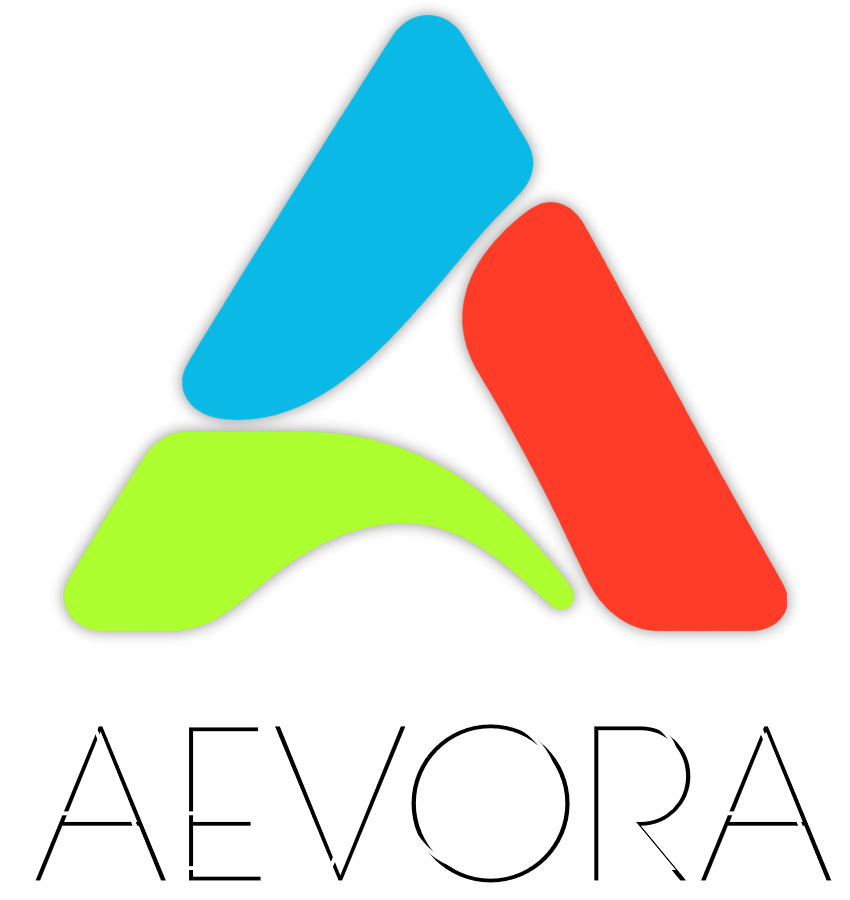

<!-- SPDX-License-Identifier: GPL-3.0-or-later -->

<!-- Copyright 2026 the NXAevora contributors -->

<p align="center">
  <picture>
    <source media="(prefers-color-scheme: dark)" srcset="assets/aevora-logo-dark.png">
    
  </picture>
</p>
<p align="center">
  
  
  
  
  
  
</p>
<p align="center">
NXAevora is a project to run Pokemon Legends Arceus natively on a Windows PC. The code of the game is translated
ahead of time from ARM64 to x86-64 with the static recompiler <a href="https://github.com/scarletnx/ScarletNX">ScarletNX</a>.<br>
NXAevora adds the settings, game code patches, runtime changes and tools that are specific to this game, and a launcher is planned.
</p>

> [!IMPORTANT]
> At Aevora, we utilize AI-powered coding (including so-called "vibe coding"). Our development is guided by human review and real-world testing, prioritizing code that is easy for humans to understand and maintain. We do not consider AI-generated code or successful compilation alone to be proof that the game is functioning correctly. If you disagree with the use of AI or do not trust AI-written code, that is your right. I do not disagree with or find those opinions unfair.

## Status

NXAevora is in alpha. It is not ready for general use.

- The base game and update 1.1.1 recompile in about 11 minutes.
- The recompiled game runs at about 30 frames each second from the first start into the Obsidian Fieldlands. This
  covers the opening scene at sea, the name entry, saving and loading, a capture, the village, a battle against an
  NPC and the first minutes in the Obsidian Fieldlands. It was tested by the author on one machine with Windows 11
  and an NVIDIA GPU.
- The static recompile covers all the code that these scenes reach. The ScarletNX runtime can still compile code at
  run time (the JIT) when the game reaches code that the recompiler missed. NXAevora keeps this as a safety net.
  The JIT was not needed in any of the tested scenes after the jump-table fix. See [ROADMAP.md](ROADMAP.md) and
  [docs/jit-analysis.md](docs/jit-analysis.md).
- Not tested yet: video, long play in the open areas, the native mouse look in cutscenes, menus and battles, and
  battles against wild Pokemon of the later areas.
- Known problems: a stop of about 1.3 seconds right after the start (the game's own loading loop, so there is no fix),
  and about 10 frames a minute that take 50 to 85 ms (the cause is not found, see
  [docs/stutter-analysis.md](docs/stutter-analysis.md)). The log of the last run lists 79 of 1787 shader programs as
  not translated. No visible fault from them has been seen. With `async_pipelines=1` the game does not stutter while
  you walk, and no late appearing objects were seen.
- The launcher does not exist yet.

## Features

- Keyboard and mouse. The keys are bound in a window, and the defaults are A: F, B: Left Shift, X: R, Y: Space,
  the arrow keys for the D-pad and W, A, S, D for the left stick. The left mouse button is ZR and the right button is
  ZL. Hold Alt to free the cursor.
- Native mouse look. A code patch of the game (`recomp/patches/native-mouse-look.pchtxt`, update 1.1.1) moves the
  camera directly with the mouse, and it does not go through the right stick.
- In-game windows made with Dear ImGui. A menu bar shows when the cursor is at the top of the picture. The window
  Controller&Keyboard has the key bindings and the button map of a gamepad. The window Display has the resolution
  scale, the anisotropic filtering, V-Sync and the performance settings. The Debug window shows the GPU, the
  processor, the memory and the frame times. The name entry of the game is a window too.
- Settings are saved in the game's `.ini` file. A setting that needs a restart says so.

The list of the changes in the runtime is in [docs/runtime-changes.md](docs/runtime-changes.md).

## What you need

- Windows 11 x64.
- A GPU and a driver with Vulkan 1.3.
- Your own copy of the game, dumped from your own console, with the update. NXAevora accepts NSP and XCI files.
- The keys of your console (`prod.keys`, and `title.keys` for NSP files), dumped from your own console.

NXAevora contains no game files and no keys. Do not ask for them and do not share them.

## Build

The [optional Vulkan world path tracer](runtime/gfx/world-pt/README.md) supports DLSS Super Resolution, FSR, and opt-in Ray Reconstruction on Windows.

Clone the repository. ScarletNX is part of it (`third_party/ScarletNX`, copied from upstream commit 8efbf9c4):

```sh
git clone <this repository>
```

The build steps for Windows are in [docs/SCARLETNX_BUILD-NOTES.md](docs/SCARLETNX_BUILD-NOTES.md). They use MSYS2
and the CLANG64 environment.

## Repository layout

| Folder                     | Content                                                |
| -------------------------- | ------------------------------------------------------ |
| `third_party/ScarletNX/` | The recompiler and the Switch runtime (vendored, changed for this game) |
| `recomp/`                | Settings and game code patches for this game          |
| `runtime/`               | Parts of the runtime that ScarletNX does not have      |
| `launcher/`              | The launcher (planned)                                 |
| `tools/`                 | Helper scripts for the analysis of the recompiled game |
| `docs/`                  | Notes and analysis                                     |

## Legal

NXAevora is an independent project. It is not affiliated with or endorsed by Nintendo, The Pokemon Company or Game
Freak. Pokemon and Pokemon Legends Arceus are trademarks of their owners.

You must own the game to use NXAevora. The files that you make with it, such as the recompiled code, come from the
game and are for your own use. Do not distribute them.

## License

NXAevora is free software under the GNU General Public License, version 3 or later. See [LICENSE](LICENSE).
ScarletNX is also GPL-3.0. Its license and the list of the projects that it builds on are in
`third_party/ScarletNX/`. The credits of NXAevora are in [docs/CREDITS.md](docs/CREDITS.md).

## Contributing

See [CONTRIBUTING.md](CONTRIBUTING.md).

The [Arceus development archive](research/arceus-complete/README.md) preserves the preceding timing, graphics, controller, research tools and runtime experiments with a verified source inventory.
